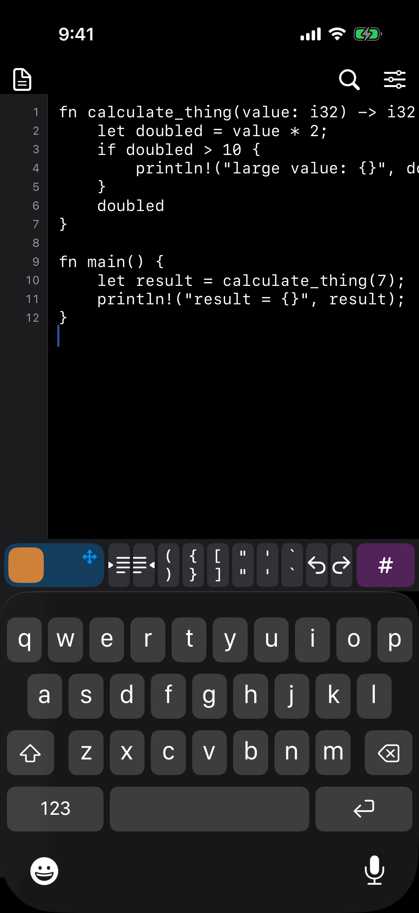
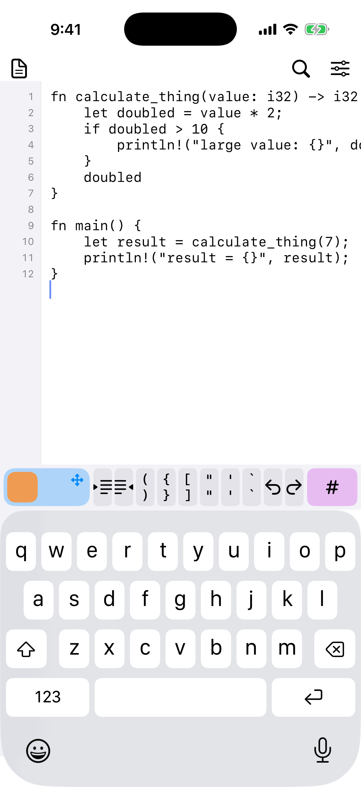

# MobileEditor

Phone-native code editing prototype. Apple's keyboard, with a configurable bar for punctuation, caret, selection, and indent.

Not an IDE. No git, files, LSP, or cloud. Open it and type.

## Screenshots

| Dark | Light |
| --- | --- |
|  |  |

Python FizzBuzz with syntax highlighting, `py` language tag, and the Run button in the top chrome.

## Install on iPhone

Gala signs and serves the current build privately. From this checkout on the Mac:

```sh
~/.local/bin/gala build --host local
~/.local/bin/gala publish --host local
```

Connect the iPhone to Tailscale, open the install page Gala prints in Safari, and tap Install. The signed build expires after 48 hours; publish again for a fresh link.

## Open in Xcode

`MobileEditor.xcodeproj`. Scheme `MobileEditor`. iPhone, iOS 17+.

Unsigned device builds are already configured (`CODE_SIGNING_ALLOWED = NO`). Gala signs the IPA for private device delivery.

Scratch text autosaves to `Documents/scratch.txt` and comes back on next launch.

## Layout

```
MobileEditor/
  MobileEditorApp.swift          SwiftUI shell
  Editor/
    EditorViewController.swift   screen, find bar, mode state
    CodeTextView.swift           UITextView, code typing traits
    EditorController.swift       move / select / indent / pairs
    TextOperations.swift         string-level edits
    EditorSettings.swift         UserDefaults knobs
    DocumentStore.swift          scratch file
    InputMode.swift
    EditorHaptics.swift
    EditorLog.swift
  Input/
    EditingAccessoryView.swift   bar above the system keyboard
    NavSelectPad.swift           corner SELECT
    HoldButton.swift             SYM hold
  Gutter/LineNumberGutter.swift
  Samples/SampleDocuments.swift
  Settings/DebugSettingsView.swift
```

UI controls call `EditorController`. Don't reach into `UITextView` ranges from buttons.

## Interaction map

No labels. Color is the mode: idle, blue NAV, orange SELECT, purple SYM.

The bar sits on Apple's keyboard. Autocap, autocorrect, smart quotes, and inline prediction are off.

**TYPE** (50 pt bar)

- By default, the larger code keys are `() . = :` plus `[]` for Python/Markdown or `{}` for TypeScript/Rust. Pair keys wrap a selection or insert-and-nest.
- Swipe `=` right for `==` or left for `=>`. Swipe `:` right for `::` or left for `:=`.
- Indent is one tap; swipe it left or hold to outdent. Undo is one tap; swipe it right or hold to redo.
- The blue KEYS button in the top chrome opens the experiment menu. Each change is saved, and the Original keyboard bar preset restores the earlier layout.
- Tap JUMP in the top bar to search visible code. Type an orange label to move the caret to its match, keep typing to narrow, or press Return for the nearest match. A unique match jumps after two search characters. The X or Escape cancels. KEYS can hide the JUMP experiment.

**NAV pad** (left, one finger)

Hold the pad. It grows. Orange square sits in the **bottom-left corner** so a thumb can slide into the corner to select.

- Stay off the square: the NAV icons move the caret.
- Slide into the corner: the square grows and sticks. Same icons now extend selection. Leave that bigger region to drop back to move. Selection stays.
- Lift: TYPE. Selection stays.

For free cursor movement, use Apple's spacebar trackpad on the system keyboard.

**NAV layer** (icons while the pad is held)

With Fixed 50 pt bar on, NAV uses one row. Swipe the left/right arrows for word moves and hold them for line start/end. Hold up/down for page moves. The ellipsis opens copy, cut, paste, and expand selection. Turn Fixed 50 pt bar off to restore the 108 pt two-row NAV layout with dedicated word, line, and clipboard keys.

**SYM** (hold `#` on the right)

Keep your thumb down and slide onto a glyph, then lift to insert it. With Fixed 50 pt bar on, the row shows `, _ / - ; ' "`; use Apple's `123` page for less common symbols. Turn the experiment off to restore the 122 pt full symbol grid. You can also tap a symbol while holding `#` with another finger.

**Gutter**

- Tap a line number: select that line.
- Drag vertically: select a line range.

**Find**

- Magnifying glass, or Cmd-F. Next / previous only.

**Return**

- Keeps the current line's indent.
- `{|}` / `(|)` / `[|]` splits into an indented inner line.

**Hardware keyboard**

- Cmd-Z / Shift-Z, C, X, V, A, F.
- Cmd-R runs the buffer.

## Run

The ▶ button in the top chrome runs the whole buffer and shows output in a console sheet: green dot + `Exit 0`, red dot otherwise, spinner while it works. Needs a network connection.

- Runs are executed remotely by Compiler Explorer (pinned compilers: CPython 3.13, rustc 1.98). No keys, no backend of ours.
- The `py` / `rs` / `ts` / `md` tag shows the active language. Picking a sample sets it; Tune can override it. It persists in UserDefaults.
- TypeScript and Markdown don't run in this build — the console says so instead of failing silently.

## Highlighting

Regex-based, per language: keywords, strings, comments, numbers, plus common types and builtins. Applied ~0.35 s after typing stops, attribute-only, so undo history and the caret are untouched. Colors are dynamic system colors, so light/dark just works. The fifth large code key follows the selected language.

## Tune

Slider icon, top right. Values persist in UserDefaults.

Worth changing on device first:

- Haptics
- Indent width / tabs
- Line wrap
- NAV/SYM delay and momentary vs toggle

Logs go to the Xcode console: `NAV_DOWN`, `SELECT_DOWN`, `MOVE_RIGHT`, `INDENT`, and so on.

## Samples

`Samples` menu: Python, TypeScript, Rust, Markdown. The code samples are FizzBuzz problem packs — a stub plus visible tests that fail until you type the fix. Python and Rust run; TypeScript is highlighting-only for now. Markdown is the prose scratch. Replacing the buffer replaces what autosaves.

## What is in v0

- Code-configured `UITextView` on Apple's keyboard
- Accessory: indent, pairs, undo, NAV, SELECT, SYM
- Smart Return
- Line gutter selection
- Find
- Debug panel
- Light / dark, monospace, almost no chrome
- Run button + console (Python, Rust via Compiler Explorer)
- Syntax highlighting (Python, TypeScript, Rust, Markdown)

## Rough edges

See `EXPERIMENTS.md`. Short version: word movement is not syntax-aware, and the corner SELECT target still needs on-device thumb time.
